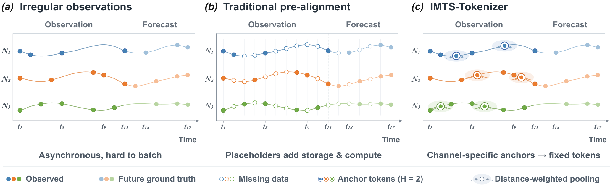
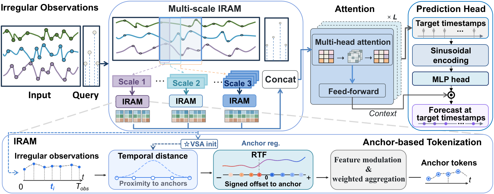
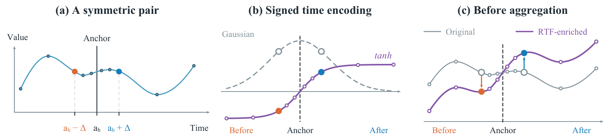

# IMTS-Tokenizer

Code for **IMTS-Tokenizer: Time-Aware Tokenization for Irregular Multivariate Time Series Forecasting**, a **NeurIPS 2026 (Poster)** paper.

[Bin Xu](https://openreview.net/profile?id=~Bin_Xu8)<sup>*</sup>, [Yinghua Li](https://openreview.net/profile?id=~Yinghua_Li3)<sup>*</sup>, [Linqi Han](https://openreview.net/profile?id=~Linqi_Han1), [Xiaoyu Li](https://openreview.net/profile?id=~Xiaoyu_Li7), [Xinghao Yang](https://openreview.net/profile?id=~Xinghao_Yang2), [Wei Liu](https://openreview.net/profile?id=~Wei_Liu15), [Yongshun Gong](https://openreview.net/profile?id=~Yongshun_Gong1)<sup>&dagger;</sup>

<sup>*</sup> These authors contributed equally.

<sup>&dagger;</sup> Corresponding author.

## Overview

Irregular multivariate time series contain sparse observations collected asynchronously across variables. Forecasting requires predicting values at specified future timestamps. IMTS-Tokenizer maps these observations to fixed-size, channel-specific anchor tokens without dense pre-alignment.



The Irregular-time-aware Module (IRAM) aggregates observations around learnable temporal anchors at multiple scales. The concatenated representations undergo cross-channel attention and are fused with sinusoidal target-time queries to produce forecasts.



Relative Time Feature (RTF) complements distance-based weighting with signed anchor-relative time features. For equal-valued observations at symmetric offsets, the odd tanh encoding produces opposite adjustments before aggregation.



## Installation

We ran the GPU experiments with Python **3.9.25**, PyTorch **2.0.0+cu117**, and CUDA **11.7**. Create a Python 3.9 environment, then install the dependencies from the repository root:

```bash
pip install -r requirements.txt
```

The parallel launcher uses Bash and NVIDIA GPUs.

## Datasets

Download ACTIVITY, PhysioNet 2012, MIMIC, and USHCN using the sources below.

### ACTIVITY

We use UCI's [Localization Data for Person Activity](https://doi.org/10.24432/C57G8X) (Vidulin et al., 2010), available under [CC BY 4.0](https://creativecommons.org/licenses/by/4.0/).

```bash
mkdir -p data/activity/raw
curl -fL 'https://archive.ics.uci.edu/ml/machine-learning-databases/00196/ConfLongDemo_JSI.txt' \
  -o data/activity/raw/ConfLongDemo_JSI.txt
```

Place only `ConfLongDemo_JSI.txt` in this raw directory. The loader groups the sensor observations and creates the tensor cache automatically.

### PhysioNet 2012

The source is [PhysioNet/Computing in Cardiology Challenge 2012, version 1.0.0](https://www.physionet.org/content/challenge-2012/1.0.0/), available under [ODC-By 1.0](https://www.physionet.org/content/challenge-2012/view-license/1.0.0/). Dataset and platform references: [Silva et al. (2012)](https://www.cinc.org/archives/2012/pdf/0245.pdf) and [Pollard et al. (2026)](https://doi.org/10.1038/s44360-026-00096-z).

We use the processed cache from [t-PatchGNN](https://github.com/usail-hkust/t-PatchGNN) ([Zhang et al., ICML 2024](https://openreview.net/forum?id=UZlMXUGI6e)).

```bash
mkdir -p data/physionet
curl -fL 'https://raw.githubusercontent.com/usail-hkust/t-PatchGNN/00c94e7bbaf21c71b03ed84ff690ae59e37129e5/data/physionet/processed.zip' \
  -o data/physionet/processed.zip && \
unzip data/physionet/processed.zip -d data/physionet
```

The archive supplies the three input caches: `processed/set-a_0.0.pt`, `processed/set-b_0.0.pt`, and `processed/set-c_0.0.pt`.

### MIMIC

Use [MIMIC-III-Ext-tPatchGNN, version 1.0.0](https://physionet.org/content/mimic-iii-ext-tpatchgnn/1.0.0/), the prepared 96-variable benchmark derived from MIMIC-III v1.4. Access is governed by the [PhysioNet Credentialed Health Data License 1.5.0](https://physionet.org/content/mimic-iii-ext-tpatchgnn/view-license/1.0.0/) and the project's data-use agreement.

Obtain access through the official PhysioNet page: become a credentialed user, complete the required **CITI Data or Specimens Only Research** training, and sign the project-specific DUA. After approval, download `mimic.pt` and place it at:

```text
data/mimic/processed/mimic.pt
```

The prepared file can be used directly. The dataset and its clinical derivatives must not be redistributed publicly under the project DUA.

References: [Yin and Zhang (2025)](https://doi.org/10.13026/ckn0-3868), [MIMIC-III v1.4 (Johnson et al., 2016)](https://doi.org/10.13026/C2XW26) and its [database paper](https://doi.org/10.1038/sdata.2016.35), together with the t-PatchGNN and PhysioNet platform papers above.

### USHCN

We use the preprocessed USHCN benchmark from [GRU-ODE-Bayes](https://github.com/edebrouwer/gru_ode_bayes), based on [NOAA/NCEI USHCN data](https://www.ncei.noaa.gov/products/land-based-station/us-historical-climatology-network). The benchmark is described by [De Brouwer et al. (NeurIPS 2019)](https://proceedings.neurips.cc/paper/2019/hash/455cb2657aaa59e32fad80cb0b65b9dc-Abstract.html); the authors' repository uses the [MIT license](https://github.com/edebrouwer/gru_ode_bayes/blob/ddd0b34e884dbee1c09b6a3927d1e9ab10443af8/License.md).

```bash
mkdir -p data/ushcn/raw
curl -fL 'https://raw.githubusercontent.com/edebrouwer/gru_ode_bayes/ddd0b34e884dbee1c09b6a3927d1e9ab10443af8/gru_ode_bayes/datasets/Climate/small_chunked_sporadic.csv' \
  -o data/ushcn/raw/small_chunked_sporadic.csv
```

The loader converts this prepared CSV directly to the tensor cache used by the model.

### Directory layout

All paths are relative to the repository root:

```text
data/
  activity/raw/ConfLongDemo_JSI.txt
  physionet/processed/set-a_0.0.pt
  physionet/processed/set-b_0.0.pt
  physionet/processed/set-c_0.0.pt
  mimic/processed/mimic.pt
  ushcn/raw/small_chunked_sporadic.csv
```

Run outputs and newly generated data caches are saved in `experiments/<timestamp>/`.

## Run the experiments

Run a single task from the repository root:

```bash
python IMTSTokenizer/run_pipeline.py --dataset mimic --seed 42 --gpu 0
```

Choose `activity`, `physionet`, `mimic`, or `ushcn` with `--dataset`. Each command runs all three stages using that dataset's defaults.

To run all four datasets and five seeds in parallel:

```bash
bash IMTSTokenizer/scripts/launch_final.sh
```

The launcher schedules 20 independent runs across four datasets and seeds **42, 43, 44, 45, 46**. It runs in the background, prints its PID and output directory, and fills GPU slots as tasks finish.

Override the available GPUs or concurrency as needed:

```bash
bash IMTSTokenizer/scripts/launch_final.sh --gpus 0 1 2 3 --per-gpu 1
```

The launcher reads dataset recipes from `IMTSTokenizer/configs/final/` and builds the job list from `final_from_scratch.json`. Each run trains the tokenizer backbone, trains the temporal correction module while keeping the backbone parameters fixed, then fits the `shrink_spectral` residual readout. Each stage loads the checkpoint produced by the preceding stage.

The recipes specify dataset-specific dimensions and training settings. MIMIC also enables the first-layer source-attention bias.

### Backbone hyperparameters

Stage-specific overrides are defined in `IMTSTokenizer/configs/final/`.

| Parameter                | ACTIVITY | MIMIC   | PHYSIONET | USHCN         |
| ------------------------ | --------:| -------:| ---------:| -------------:|
| `hid_dim` (anchor count) | 12       | 16      | 24        | 2             |
| Number of scales         | 2        | 2       | 2         | 4             |
| `num_layers`             | 4        | 2       | 2         | 5             |
| Learning-rate schedule   | plateau  | plateau | plateau   | milestone [8] |
| `patch_size`             | 1500     | 12      | 12        | 3             |
| `history`                | 3000     | 24      | 24        | 24            |
| `num_var`                | 12       | 96      | 41        | 5             |
| `dropout`                | 0.1      | 0.2     | 0         | 0             |
| `batch_size`             | 32       | 32      | 32        | 192           |
| `lr`                     | 1e-3     | 1e-3    | 1e-3      | 1e-3          |
| `patience`               | 12       | 12      | 12        | 10            |

`CONFIGS` in `IMTSTokenizer/scripts/run_parallel.py` defines dataset defaults; each JSON recipe provides stage-specific overrides.

### Run with custom parameters

Pass hyperparameters directly on the command line:

```bash
python IMTSTokenizer/run_pipeline.py --dataset mimic --seed 42 --gpu 0 --hid_dim 24 --num_layers 3 --lr 0.0005 --batch_size 16 --epoch 100
```

Unspecified options retain the dataset defaults. `--lr`, `--patience`, and `--epoch` apply to both neural training stages; `--batch_size` applies to all three stages. Architecture settings such as `--hid_dim`, `--num_layers`, and `--dropout` are inherited by the later stages. For different stage settings, use `--correct-lr`, `--correct-batch-size`, or `--readout-batch-size`.

## Acknowledgements and licenses

The benchmark and data utilities build on [t-PatchGNN](https://github.com/usail-hkust/t-PatchGNN), [Latent ODE](https://github.com/YuliaRubanova/latent_ode), and [GRU-ODE-Bayes](https://github.com/edebrouwer/gru_ode_bayes).

Original code contributions use the [MIT license](LICENSE); third-party notices are retained in [LICENSES](LICENSES/). The paper and its illustrations are [CC BY 4.0](https://creativecommons.org/licenses/by/4.0/), with attribution in [figs/LICENSE.md](figs/LICENSE.md).

## Citation

We welcome citations to our paper when this work is useful to your research:

```bibtex
@inproceedings{imtstokenizer,
  title     = {{IMTS-Tokenizer}: Time-Aware Tokenization for Irregular Multivariate Time Series Forecasting},
  author    = {Xu, Bin and Li, Yinghua and Han, Linqi and Li, Xiaoyu and Yang, Xinghao and Liu, Wei and Gong, Yongshun},
  booktitle = {Advances in Neural Information Processing Systems},
  year      = {2026}
}
```
